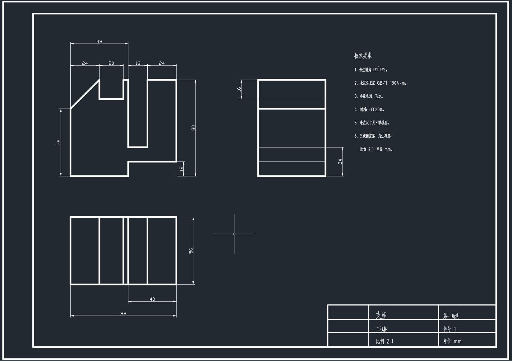
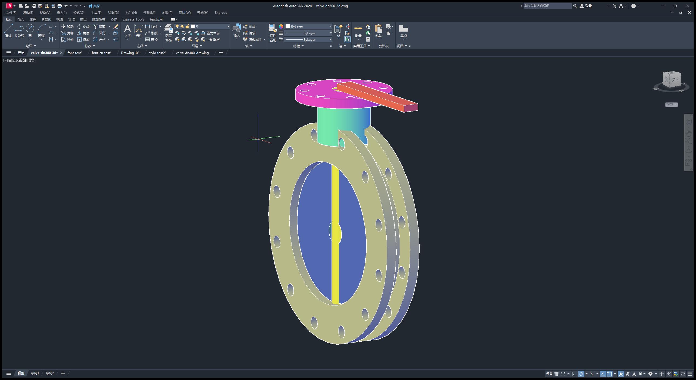

# DSH AutoCAD Bridge

Give **AutoCAD 2024** to a DeepSeek Harness agent as a pair of hands: query status, draw entities, manage layers, send native commands, build 3D solids — all through MCP tool calls. Ships with a **control panel** that owns the bridge process: start/stop/restart, settings, a status light and live logs.

> 中文: [README.md](README.md)



---

## What it solves

AutoCAD is a desktop GUI with no HTTP API. Driving it from an agent needs a layer that turns command-line-style COM calls into structured tool calls. This project is that layer, plus a plugin that supervises it.

```
┌──────────────────────────────────────────────────────────────┐
│  DeepSeek Harness (web surface / Electron desktop surface)   │
│                                                              │
│   Agent ──► mcp__autocad__cad_add_circle(...)                │
│                    │                                         │
│                    ▼                                         │
│   @deepseek-ai/dsh-mcp-client  ── HTTP/SSE ──┐               │
│                                             │               │
│   @local/autocad-bridge (this repo) ◄───────┼── control panel │
│     · owns the Python bridge process         │   start/stop  │
│     · persists settings · auto-restarts      │   settings    │
│                                              │   live logs   │
└─────────────────────────────────────────────┼───────────────┘
                                              │
                        ┌─────────────────────▼──────────────┐
                        │  bridge/autocad_server.py          │
                        │  (Python · MCP server · stdio/HTTP)│
                        │            │                       │
                        │            ▼                       │
                        │  bridge/cad_com.py                 │
                        │  one STA thread + command queue     │
                        └────────────┼───────────────────────┘
                                     │ COM (pywin32)
                                     ▼
                        ┌────────────────────────────────────┐
                        │  AutoCAD 2024 (acad.exe)           │
                        └────────────────────────────────────┘
```

The split exists because **the bridge only knows AutoCAD, and the plugin only knows processes and pixels.** The bridge can be tested on its own; the panel can be re-pointed at a different bridge without touching the UI.

---

## Features

### Control panel

One sidebar icon, one full central panel:

- **Status light** — green: process up and port reachable; amber: process up, port dead; grey: stopped
- **Start / stop / restart** — no more hunting `python.exe` in Task Manager
- **Settings** — Python path, server script, working directory, port, ProgID; saved on the spot
- **Live logs** — the bridge's stdout/stderr stream into the panel, 600-line ring buffer
- **Crash watchdog** — after an unexpected exit it relaunches with 1s→2s→4s… exponential back-off capped at 30s, stands down after 8 consecutive failures
- **Dependency bootstrap** — builds a virtual environment in your data directory and installs pywin32 / mcp / python-dotenv on demand
- **Discovery** — finds Python and the bridge directory, detects which AutoCAD ProgIDs your machine actually registers

### 18 agent tools

| Tool | Purpose |
|---|---|
| `cad_connect` | Connect (launches AutoCAD through COM when it is not running) |
| `cad_status` | `disconnected` / `idle` / `busy` / `error` |
| `cad_escape` | Send ESC to cancel a command and dismiss a modal dialog |
| `cad_list_progids` | ProgIDs actually present in the registry |
| `cad_list_documents` | Open DWGs, marking the active one |
| `cad_new_document` | New drawing (optional dwt template) |
| `cad_save` | Save in place, or save-as |
| `cad_ensure_layer` | Create a layer (reuse when it exists); colour name or ACI index |
| `cad_list_layers` | All layers with colours |
| `cad_add_line` | Line |
| `cad_add_circle` | Circle |
| `cad_add_rectangle` | Rectangle |
| `cad_add_polyline` | Polyline (may close) |
| `cad_add_text` | Single-line text |
| `cad_add_arc` | Arc (angles in degrees) |
| `cad_send_command` | Any native command, e.g. `_.ZOOM\n_E\n` |
| `cad_list_entities` | Model-space entities (type / layer / handle) |
| `cad_zoom_extents` | Zoom to extents |

3D solids (`AddBox` / `AddCylinder` / `Boolean` / `Rotate3D`) are driven through `cad_send_command` with a Python script — see [Examples](#examples).

---

## Install

### Requirements

- Windows (COM)
- AutoCAD **2024** (other releases need a different ProgID — see [troubleshooting](docs/troubleshooting.md#progid))
- Python 3.10–3.12 (do **not** install into the system interpreter; the plugin builds its own venv)
- DeepSeek Harness

### Steps

1. Clone anywhere:

   ```powershell
   git clone https://github.com/cmm00100/dsh-autocad-bridge.git
   ```

2. Install the bundle into your DSH profile, pointing at `bundle-autocad-ui`:

   ```powershell
   dsh plugin --profile web add <clone-path>\bundle-autocad-ui
   ```

3. Open **Settings → Plugins** and confirm the `autocad-bridge` row is enabled.

4. Click the **AutoCAD Bridge** icon in the sidebar, then **Install dependencies**. The plugin creates a virtual environment under `%USERPROFILE%\.dsh\autocad-bridge\`, installs the three dependencies, and starts the bridge.

5. Once the light is green, have the agent call `mcp__autocad__cad_connect`.

Settings live in `%USERPROFILE%\.dsh\autocad-bridge\config.json`; the venv sits next to it.

---

## Configuration

Everything editable in the panel lands in `config.json`:

| Field | Default | Meaning |
|---|---|---|
| `pythonPath` | auto-detected | Interpreter running the bridge |
| `serverScript` | auto-detected | Absolute path to `autocad_server.py` |
| `workingDirectory` | auto-detected | Working directory of the bridge process |
| `httpPort` | `8770` | HTTP port; must match the MCP client's `url` |
| `progId` | `AutoCAD.Application.24` | See table below |
| `autoStart` | `true` | Launch the bridge when the plugin loads |

| AutoCAD | ProgID |
|---|---|
| 2024 | `AutoCAD.Application.24` |
| 2023 | `AutoCAD.Application.23` |
| 2022 | `AutoCAD.Application.22` |

Unsure? Run `cad_list_progids` — it reads the registry.

The bridge also carries a `.env` (in `bundle-autocad-ui/bridge/`) for timeouts, retries and the default layer. You rarely need to touch it.

---

## Examples

`examples/` holds three runnable scripts showing how far this goes:

| Script | Result |
|---|---|
| `part-3view.py` | Three-view drawing of a part from an isometric reference; A3 sheet, 2:1, 13 dimensions |
| `valve-3view.py` | DN300 butterfly valve three-view; A0 sheet, 18 dimensions, parts list, technical notes |
| `valve-3d.py` | The same valve as a 3D multi-colour assembly (6 parts / 6 layers / 6 colours) |

```powershell
<venv-python> examples\valve-3d.py
```

Output lands in `examples/out/`. **Make sure AutoCAD is running and idle first** — the script draws into the active document.



---

## Documentation

- [Architecture and trade-offs](docs/architecture.md) — why one STA thread plus a queue, why two layers
- [Tool semantics worth knowing](docs/api-semantics.md) — where AutoCAD COM disagrees with its own documentation
- [Troubleshooting](docs/troubleshooting.md) — cannot connect, hangs, mojibake, save failures
- [Limitations](docs/limitations.md)

---

## Known limitations

- **Windows only** — COM.
- **AutoCAD must be running** — silent background COM is unreliable; the plugin launches it with a window.
- **Modal dialogs freeze COM** — every call stalls until dismissed; `cad_escape` is the escape hatch.
- **Serial by design** — all COM calls queue through one STA thread. Concurrent calls are safe, not faster: AutoCAD itself is single-threaded.
- **No visual verification** — the bridge draws. Whether it looks right is a separate question.
- **The panel's pixel rendering is not automatically verified** — its logic is covered by headless tests, but the appearance needs a human glance (see [limitations](docs/limitations.md)).

---

## Credits

- [DeepSeek Harness](https://github.com/deepseek-ai/dsh) — plugin host
- [Model Context Protocol](https://modelcontextprotocol.io/) — bridge-to-agent protocol
- [pywin32](https://github.com/mhammond/pywin32) — COM bindings

## License

[MIT](LICENSE)
