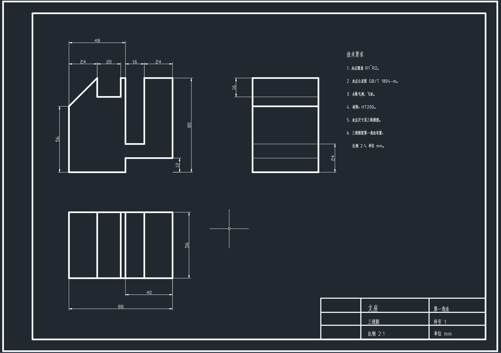
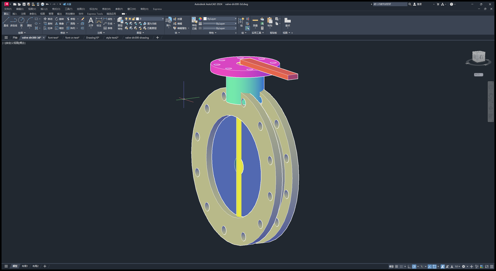

# DSH AutoCAD Bridge

Give **AutoCAD 2024** to a DeepSeek Harness agent as a pair of hands: query status, draw entities, manage layers, **GB-standard dimensions**, blocks with attributes, MText / geometric tolerances, mechanical aids, xrefs, auto-BOM, **batch DXF/DWG/PDF delivery** and **3D solid modelling / 2D→3D reasoning** — all through MCP tool calls. Ships with a **control panel** that owns the bridge process: start/stop/restart, settings, a status light and live logs.

**Current version 1.3.0** (V1.3 2D→3D / parametric solid modelling): 70 tools,
one call to turn part dimensions into a 3D solid with an isometric view;
V1.2's "batch-organise a whole set of equipment drawings, generate the BOM
and deliver PDFs" and V1.1's "set up the drafting environment + draw +
auto-dimension + auto-layer" are also one call each. Roadmap:
[docs/ROADMAP.md](docs/ROADMAP.md); changes: [CHANGELOG.md](CHANGELOG.md).

> 中文: [README.md](README.md)



---

## What it solves

AutoCAD is a desktop GUI with no HTTP API. Driving it from an agent needs a layer that turns command-line-style COM calls into structured tool calls. This project is that layer, plus a plugin that supervises it.

```
┌──────────────────────────────────────────────────────────────┐
│  DeepSeek Harness (web surface / Electron desktop surface)   │
│                                                              │
│   Agent ──► mcp__autocad__cad_add_circle(...)                │
│                    │                                         │
│                    ▼                                         │
│   @deepseek-ai/dsh-mcp-client  ── HTTP/SSE ──┐               │
│                                             │               │
│   dsh-autocad-bridge (this repo) ◄─────────┼── control panel │
│     · owns the Python bridge process         │   start/stop  │
│     · persists settings · auto-restarts      │   settings    │
│                                              │   live logs   │
└─────────────────────────────────────────────┼───────────────┘
                                              │
                        ┌─────────────────────▼──────────────┐
                        │  bridge/autocad_server.py          │
                        │  (Python · MCP server · stdio/HTTP)│
                        │            │                       │
                        │            ▼                       │
                        │  bridge/cad_com.py                 │
                        │  one STA thread + command queue     │
                        └────────────┼───────────────────────┘
                                     │ COM (pywin32)
                                     ▼
                        ┌────────────────────────────────────┐
                        │  AutoCAD 2024 (acad.exe)           │
                        └────────────────────────────────────┘
```

The split exists because **the bridge only knows AutoCAD, and the plugin only knows processes and pixels.** The bridge can be tested on its own; the panel can be re-pointed at a different bridge without touching the UI.

---

## Features

### Control panel

One sidebar icon, one full central panel:

- **Status light** — green: process up and port reachable; amber: process up, port dead; grey: stopped
- **Start / stop / restart** — no more hunting `python.exe` in Task Manager
- **Settings** — Python path, server script, working directory, port, ProgID; saved on the spot
- **Live logs** — the bridge's stdout/stderr stream into the panel, 600-line ring buffer
- **Crash watchdog** — after an unexpected exit it relaunches with 1s→2s→4s… exponential back-off capped at 30s, stands down after 8 consecutive failures
- **Dependency bootstrap** — builds a virtual environment in your data directory and installs pywin32 / mcp / python-dotenv on demand
- **Discovery** — finds Python and the bridge directory, detects which AutoCAD ProgIDs your machine actually registers

### 70 agent tools

#### Base (V1.0, 18 — all kept)

| Tool | Purpose |
|---|---|
| `cad_connect` | Connect (launches AutoCAD through COM when it is not running) |
| `cad_status` | `disconnected` / `idle` / `busy` / `error`, plus queue health |
| `cad_escape` | Send ESC to cancel a command and dismiss a modal dialog |
| `cad_reconnect` | Rebuild the COM connection after a hang/timeout (V1.1) |
| `cad_list_progids` | ProgIDs actually present in the registry |
| `cad_list_documents` | Open DWGs, marking the active one |
| `cad_new_document` | New drawing (optional dwt template) |
| `cad_save` | Save in place, or save-as |
| `cad_ensure_layer` | Create a layer (reuse when it exists); colour name or ACI index |
| `cad_list_layers` | All layers with colours |
| `cad_add_line` | Line |
| `cad_add_circle` | Circle |
| `cad_add_rectangle` | Rectangle |
| `cad_add_polyline` | Polyline (may close) |
| `cad_add_text` | Single-line text |
| `cad_add_arc` | Arc (angles in degrees) |
| `cad_send_command` | Any native command, e.g. `_.ZOOM\n_E\n` |
| `cad_list_entities` | Model-space entities (type / layer / handle) |
| `cad_zoom_extents` | Zoom to extents |

#### V1.1 industrial foundations (21)

| Group | Tool | Purpose |
|---|---|---|
| Dim | `cad_setup_text_style` | Chinese text style (`gbenor.shx` + `gbcbig.shx`) |
| Dim | `cad_setup_gb_dim_style` | GB dimension style (24 `DIM*` variables) |
| Dim | `cad_add_dim_linear` | Linear / horizontal / vertical |
| Dim | `cad_add_dim_aligned` | Aligned |
| Dim | `cad_add_dim_radial` | Radius |
| Dim | `cad_add_dim_diametric` | Diameter |
| Dim | `cad_add_dim_angular` | Angular |
| Dim | `cad_add_dim_ordinate` | Ordinate |
| Layer | `cad_setup_standard_layers` | Create all 6 mechanical standard layers |
| Layer | `cad_set_layer_state` | Bulk lock / freeze / colour / lineweight / active |
| Layer | `cad_set_active_layer` | Switch the current layer |
| Env | `cad_setup_mechanical_environment` | **One call to set up the whole environment** |
| Block | `cad_list_blocks` | Block definitions |
| Block | `cad_create_block` | New block (with attributes), idempotent |
| Block | `cad_insert_block` | Insert; override attributes, rotate, scale |
| Block | `cad_list_block_attributes` | Read a reference's attributes |
| Block | `cad_set_block_attribute` | Change one attribute value |
| Block | `cad_replace_block` | Bulk-replace references |
| Text | `cad_add_mtext` | Multi-line text (incl. stacked tolerances) |
| Text | `cad_add_tolerance` | Geometric tolerance frame |

#### V1.2 non-standard automation (17)

| Group | Tool | Purpose |
|---|---|---|
| Mechanical | `cad_add_centerlines` | Auto centre lines from two rectangle corners |
| Mechanical | `cad_mirror_entities` | Mirror geometry about an axis |
| Mechanical | `cad_offset_entity` | Offset one entity by a distance |
| Mechanical | `cad_array_rectangular` | Rectangular array |
| Mechanical | `cad_array_polar` | Polar array (angle in degrees) |
| Mechanical | `cad_trim_at_points` | Batch trim via native `_.TRIM` |
| Xref | `cad_list_xrefs` | List xrefs and their paths |
| Xref | `cad_attach_xref` | Attach a DWG xref |
| Xref | `cad_xref_action` | Bind / unload / reload / detach / repair one xref |
| Xref | `cad_repair_xref_paths` | Bulk-fix path prefixes |
| BOM | `cad_count_blocks` | Count block references + attribute samples |
| BOM | `cad_generate_bom` | Auto BOM table (optionally bottom-right aligned) |
| Batch | `cad_unify_styles` | Unify text styles / layers |
| Batch | `cad_export_dxf` | Export current drawing to DXF |
| Batch | `cad_export_dwg` | Export current drawing to DWG (Wblock) |
| Batch | `cad_export_pdf` | Plot current drawing to PDF |
| Batch | `cad_batch_convert` | **One call: organise a drawing set + BOM + PDF delivery** |

#### One call to deliver a whole drawing set

```
cad_batch_convert(paths=[...], out_dir=..., formats=["dxf","dwg","pdf"])
    -> open each, unify fonts, export all three formats, close
cad_generate_bom()                 -> count blocks, build BOM, bottom-right align
cad_unify_styles(style="DSH-CN")  -> bulk-unify fonts / layers
```

`cad_batch_convert` gives each document its own STA call, a globally unique
SelectionSet name, and a wider BUSY retry window (after consecutive exports
AutoCAD stays busy for 2–5 s); 3 drawings in a row verified 3/3.

#### V1.3 3D loop (14)

| Group | Tool | What it does |
|---|---|---|
| Primitives | `cad_add_3d_primitive` | 7 primitives: box/cylinder/sphere/cone/torus/wedge |
| Modelling | `cad_extrude_profile` | Closed profile -> region -> extruded solid |
| Modelling | `cad_revolve_profile` | Revolve a closed profile about an axis |
| Modelling | `cad_sweep_profile` | Sweep a closed profile along a line path |
| Modelling | `cad_boolean_solids` | Union / intersect / subtract |
| Modelling | `cad_rotate_3d` | Rotate a solid about a 3D axis |
| Modelling | `cad_slice_solid` | Slice a solid with a 3-point plane |
| Modelling | `cad_section_solid` | Section (region) of a solid |
| Modelling | `cad_solid_info` | Bounding box / layer / liveness |
| Modelling | `cad_fillet_edges` / `cad_chamfer_edges` | Fillet / chamfer (command, async) |
| Views | `cad_set_3d_view` | iso/front/back/top/bottom/right/left + shade |
| 2D→3D | `cad_dimensions_to_3d` | **Dimensions -> solid + isometric + shade** |
| 2D→3D | `cad_profile_to_3d` | **Closed sketch + thickness -> solid + isometric + shade** |

#### One call from dimensions to a 3D model

```
cad_dimensions_to_3d(length=44, width=28, height=40)
    -> box occupying [0,44]x[0,28]x[0,40] + auto isometric + Conceptual shade
cad_profile_to_3d(points=[[0,0],[60,0],[60,40],[0,40]], thickness=12)
    -> extruded solid + auto isometric + shade
cad_set_3d_view(view="front", shade="Realistic")  -> switch to front view
```

Measured facts: a primitive's `center` is the **geometric centre** (symmetric in
Z), `Boolean` is `0=union / 1=intersect / 2=subtract` (**opposite to the docs**),
all 3D angle arguments are **degrees** (radians inside COM). `cad_fillet_edges`
/ `cad_chamfer_edges` go through `_.FILLETEDGE` / `_.CHAMFEREDGE` commands and
are fire-and-forget — verify visually in CAD. View direction is changed with
pure COM on `ActiveViewport.Direction` **assigned back**, then verified with
`VIEWDIR`; no bare `VPOINT` command is ever sent.

#### One call to a part drawing

```
cad_setup_mechanical_environment   -> layers, fonts, GB dim style, auto-layering on
cad_add_rectangle / cad_add_circle -> outlines land on the "outline" layer
cad_add_dim_linear / ...           -> dimensions land on the "dimension" layer
cad_zoom_extents                   -> fit
```

All angles are in **degrees** (converted to radians internally). Dimensions
auto-land on the "dimension" layer and accept text overrides. Auto-layering is
off by default and only turns on after `cad_setup_mechanical_environment` — a
deliberate backward-compatibility choice.

3D solids (`AddBox` / `AddCylinder` / `Boolean` / `Rotate3D`) are driven through
`cad_send_command` with a Python script — see [Examples](#examples). Native 3D
tools are planned for V1.3, see [ROADMAP](docs/ROADMAP.md).

---

## Install

### Requirements

- Windows (COM)
- AutoCAD **2024** (other releases need a different ProgID — see [troubleshooting](docs/troubleshooting.md#progid))
- Python 3.10–3.12 (do **not** install into the system interpreter; the plugin builds its own venv)
- DeepSeek Harness

### Steps

1. Install the bundle into your DSH profile. What you install is the `bundle-autocad-ui` subdirectory of this repo, in one command:

   ```powershell
   dsh plugin --profile web add github:cmm00100/dsh-autocad-bridge#path:/bundle-autocad-ui
   ```

   To hack on the code instead, clone it and point at the local directory:

   ```powershell
   git clone https://github.com/cmm00100/dsh-autocad-bridge.git
   dsh plugin --profile web add <clone-path>\bundle-autocad-ui
   ```

   The agent can also call `plugin_manager`'s `install_bundle` with the same target.

2. Open **Settings → Plugins** and confirm the `autocad-bridge` row is enabled.

3. Click the **AutoCAD Bridge** icon in the sidebar, then **Install dependencies**. The plugin creates a virtual environment under `%USERPROFILE%\.dsh\autocad-bridge\`, installs the three dependencies, and starts the bridge.

4. Once the light is green, have the agent call `mcp__autocad__cad_connect`.

Settings live in `%USERPROFILE%\.dsh\autocad-bridge\config.json`; the venv sits next to it.

---

## Configuration

Everything editable in the panel lands in `config.json`:

| Field | Default | Meaning |
|---|---|---|
| `pythonPath` | auto-detected | Interpreter running the bridge |
| `serverScript` | auto-detected | Absolute path to `autocad_server.py` |
| `workingDirectory` | auto-detected | Working directory of the bridge process |
| `httpPort` | `8770` | HTTP port; must match the MCP client's `url` |
| `progId` | `AutoCAD.Application.24` | See table below |
| `autoStart` | `true` | Launch the bridge when the plugin loads |

| AutoCAD | ProgID |
|---|---|
| 2024 | `AutoCAD.Application.24` |
| 2023 | `AutoCAD.Application.23` |
| 2022 | `AutoCAD.Application.22` |

Unsure? Run `cad_list_progids` — it reads the registry.

The bridge also carries a `.env` (in `bundle-autocad-ui/bridge/`) for timeouts, retries and the default layer. You rarely need to touch it.

---

## Examples

`examples/` holds three runnable scripts showing how far this goes:

| Script | Result |
|---|---|
| `part-3view.py` | Three-view drawing of a part from an isometric reference; A3 sheet, 2:1, 13 dimensions |
| `valve-3view.py` | DN300 butterfly valve three-view; A0 sheet, 18 dimensions, parts list, technical notes |
| `valve-3d.py` | The same valve as a 3D multi-colour assembly (6 parts / 6 layers / 6 colours) |

```powershell
<venv-python> examples\valve-3d.py
```

Output lands in `examples/out/`. **Make sure AutoCAD is running and idle first** — the script draws into the active document.



---

## Documentation

- [Architecture and trade-offs](docs/architecture.md) — why one STA thread plus a queue, why two layers
- [Tool semantics worth knowing](docs/api-semantics.md) — where AutoCAD COM disagrees with its own documentation
- [Troubleshooting](docs/troubleshooting.md) — cannot connect, hangs, mojibake, save failures
- [Limitations](docs/limitations.md)

---

## Known limitations

- **Windows only** — COM.
- **AutoCAD must be a desktop process** — the bridge auto-launches `acad.exe`
  over COM (V1.1 cold-start wake-up verified: ~15 s after a forced kill), but
  silent background COM is still unreliable. Keep the CAD window open.
- **Modal dialogs freeze COM** — every call stalls until dismissed. `cad_escape`
  is the escape hatch; `cad_status` now reports queue backlog and how long the
  worker has been stuck, and `cad_reconnect` rebuilds the connection.
- **Serial by design** — all COM calls queue through one STA thread. Concurrent calls are safe, not faster: AutoCAD itself is single-threaded.
- **No visual verification** — the bridge draws. Whether it looks right is a separate question.
- **Batch export is serial and has no transactional rollback** — after consecutive
  exports AutoCAD stays busy 2–5 s; `cad_batch_convert` uses a wider retry window,
  but a failed run may still leave partial output to clean up (see [limitations](docs/limitations.md)).
- **The panel's pixel rendering is not automatically verified** — its logic is covered by headless tests, but the appearance needs a human glance (see [limitations](docs/limitations.md)).

---

## Credits

- [DeepSeek Harness](https://github.com/deepseek-ai/dsh) — plugin host
- [Model Context Protocol](https://modelcontextprotocol.io/) — bridge-to-agent protocol
- [pywin32](https://github.com/mhammond/pywin32) — COM bindings

## License

[MIT](LICENSE)
